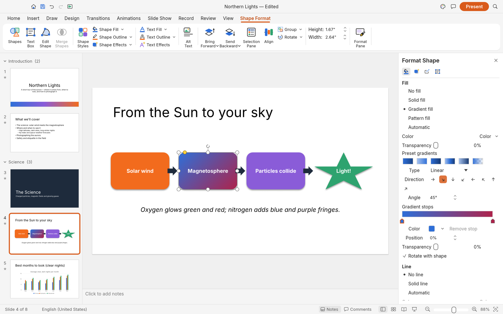
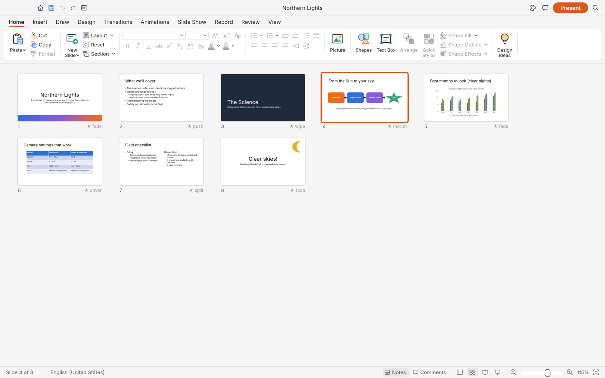

<p align="center">
  <a href="../../releases">
    <picture>
      <source media="(prefers-color-scheme: dark)" srcset="docs/brand/artcraft-logo-white.svg">
      
    </picture>
  </a>
</p>

<h1 align="center">DeckCraft</h1>

<p align="center">
  <b>Presentations and slide shows; an open-source, clean-room reimplementation of Microsoft PowerPoint, rebuilt in pure Rust.</b>
</p>

<p align="center">
  Build decks with themes, layouts, shapes, pictures, tables, charts, transitions and animations,
  open and save PowerPoint files, and present them full screen. Native on macOS, Windows, Linux
  and FreeBSD, and in the browser. Every button is also a command that the CLI and AI agents
  (through MCP) can drive.
</p>

<p align="center">
  
  
  
  
</p>

## What works today

DeckCraft is in early development, heading for its first alpha.
Today it can:

- **Make decks**: slide masters and eleven layouts with placeholders that inherit position and
  formatting, eight original themes with colour and font schemes, sections, notes, comments,
  headers and footers, custom slide sizes.
- **Draw**: 150+ preset shapes with adjust handles, connectors that stay glued to shapes, freeform,
  curve and scribble tools, merge shapes (union, combine, fragment, intersect, subtract), gradient,
  picture and pattern fills, outlines with dashes and arrowheads, shadows, glow, soft edges and
  reflections.
- **Write**: in-place text editing with full font and paragraph formatting, bullets and numbering,
  columns, autofit, vertical text, fields and hyperlinks.
- **Add content**: pictures with crop and corrections, tables with styles, charts, SmartArt basics,
  audio and video (MP3, AAC, FLAC, ALAC, Ogg, Opus, WAV, AIFF; H.264, HEVC, VP9, AV1).
- **Present**: transitions (including Morph), entrance/emphasis/exit and motion-path animations,
  by-paragraph builds, full-screen slide show, presenter view, pen, rehearse timings, media playback.
- **Exchange files**: open and save PowerPoint `.pptx`, export PDF (slides, notes pages, handouts
  with selectable text), PNG/JPEG and outlines. Unsaved work is kept by AutoRecover.
- **Automate**: 200+ commands with undo, all scriptable from the CLI, a JSON control channel and an
  MCP server for AI agents.

<table>
  <tr>
    <td width="50%"><br><sub>Shape Format contextual tab and selection handles</sub></td>
    <td width="50%"><br><sub>Format Shape pane: gradient type, direction and stops</sub></td>
  </tr>
  <tr>
    <td width="50%"><br><sub>Slide Sorter with each slide's transition</sub></td>
    <td width="50%"><br><sub>Dark mode, with a native chart</sub></td>
  </tr>
</table>

<p align="center">
  <br>
</p>

## Getting started

[View all releases](../../releases)

| Platform | Download | Run |
|----------|----------|-----|
| **Windows x64** | [deckcraft-x64.7z](../../releases) | Run installer → launch `deckcraft-x64.7z` |
| **Linux x64** | [deckcraft-Linux-x64.run](../../releases) | `chmod +x` → run installer |
| **macOS Apple Silicon** | [deckcraft-macOS-arm64.dmg](../../releases) | Open DMG → drag to Applications |

### Logs

The desktop app writes its `log` records to standard error and to `logs/deckcraft.log` in the
settings directory, beside `ui.json` and `prefs.json` (Linux `~/.config/deckcraft/logs/`, or
`$XDG_CONFIG_HOME/deckcraft/logs/`; macOS `~/Library/Application Support/DeckCraft/logs/`; Windows
`%APPDATA%\DeckCraft\logs\`). A start from a desktop menu or the Dock has no terminal, so this file
is what to attach to a bug report: the crash guard's panic report, a failed crash-recovery save,
PowerPoint parts skipped on import and audio output problems land there. Each launch moves the
previous log to `deckcraft.1.log` (and that one to `deckcraft.2.log`), so the log of a run that
crashed survives the next start. The file stops growing at 16 MiB. `--version` writes no file.

| Variable | Effect |
|---|---|
| `RUST_LOG` | Log levels for standard error and the log file. Default: `info` for DeckCraft's own crates, `warn` for everything else. env_logger-style directives replace that, e.g. `RUST_LOG=debug`, `RUST_LOG=warn,deckcraft_pptx=trace` or `RUST_LOG=info,wgpu_core=warn`; a directive ending in `*` covers every target starting with it (`deckcraft*=debug`). |

The logger is `apps/deckcraft/src/logging.rs`; the realtime audio callback does not log. The web
app logs to the browser console instead.

## Agents, CLI and MCP

Every action in DeckCraft is a command with a stable id, so people, scripts and AI agents use the
same verbs:

```sh
deckcraft-cli commands format.          # list commands
deckcraft-cli run --sample --cmd 'slide.new={"layout":"titleOnly","title":"Hello"}' --save hello.deckcraft
deckcraft-cli mcp                       # MCP server over stdio (headless)
deckcraft-cli mcp --connect 7990        # drive the running app (deckcraft --control 7990)
```

## Roadmap

DeckCraft covers about **79% of PowerPoint's features by breadth** (93% of the core ones) and is
roughly **80% of the way to a first alpha**. See [ROADMAP.md](ROADMAP.md) for the alpha checklist,
parity estimates and what's next, and [docs/parity.md](docs/parity.md) for the feature-by-feature
scorecard.

## License and credits

DeckCraft is dual-licensed under [MIT](LICENSE-MIT) or [Apache-2.0](LICENSE-APACHE), at your option.
Copyright (c) 2026 ArtCraft Team and the DeckCraft contributors. Required notices are in [NOTICE](NOTICE).
Made by the <a href="https://getartcraft.com/">ArtCraft</a> team and community.</sub>
